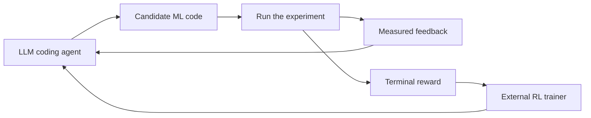

# RSI Environments

**Reinforcement-learning environments for LLM agents that improve machine-learning systems.**

**Apple GPU functionally verified:** one real TinyStories inner-GPT smoke completed on Apple MPS with 5,063,424 parameters. The fixed smoke protocol made 3 scheduled training calls (2 with positive learning rate), processed 96 training tokens and graded 64 development tokens. This verifies a bounded inner-model GPU execution path; it does not measure before/after learning gain, standard CUDA execution, or coding-agent RL.

An agent writes code, runs an experiment, reads the result, and tries again. These environments turn that work into measurable feedback and rewards that an external RL trainer can use to improve the agent.

The suite includes **inference optimization, training improvement, kernel optimization, and a shared Verifiers adapter**. The latest release records real Apple GPU training execution and adds a [NVIDIA training guide](docs/nvidia-training.md) with native CUDA steps and pinned external-trainer example configurations.

> The three environments have different accelerator evidence. See [the Apple GPU check](docs/apple-gpu-check.md) for the MPS result and the CUDA scope. Coding-agent weight training, learned policy improvements, and calibrated accelerator performance remain unverified. Use trusted local research code.

## Why recursive self-improvement?

A language model can help improve the systems used to train and run language models. That creates a useful research loop: the model proposes a change, an experiment measures it, and the result teaches the model how to make better changes.



This repository supplies the **execution and reward layer** of that loop. Editing code across several attempts is test-time search. Updating the coding agent's weights is RL training. Demonstrating recursive improvement requires showing that an improved agent becomes better at producing further improvements. Those are separate experiments; this release does not claim the last two have already happened.

## Three environments

| Environment | What the agent changes | What earns a reward |
|---|---|---|
| [Inference optimization](inference/README.md) | The inference implementation of a fixed pretrained SmolLM2-135M | Faster execution while passing output checks |
| [Training improvement](training-env/README.md) | A small language model, its optimizer, and its training step | Lower independently measured held-out loss under the task budget |
| [Kernel optimization](kernel-env/README.md) | PyTorch/Metal implementations of numerical operations | Faster execution while passing numerical correctness checks |

The kernel catalog includes RMSNorm, softmax, SwiGLU, cross-entropy, causal attention, and Newton–Schulz. Four operations are training tasks; attention and Newton–Schulz are evaluation-only tasks.

In the training-improvement environment, a small GPT is trained **inside each experiment**. Its loss grades the submitted code. The outer LLM coding policy is the model an RL trainer would subsequently update.

## Start with a small CPU task

CPU remains the quickest way to explore the environments. The current release also records a bounded Apple MPS smoke; this quickstart is a convenience path, not the release headline.

Use Python **3.12** for the complete suite. The kernel package also supports Python 3.11+. Create an environment and install the kernel task:

```bash
git clone https://github.com/vukrosic/rsi-environments.git
cd rsi-environments
python3.12 -m venv .venv
source .venv/bin/activate
python -m pip install -e './kernel-env[test]'

cd kernel-env
kernel-env init softmax work/softmax.py
kernel-env evaluate softmax work/softmax.py --profile smoke --device cpu --trials 3
```

Edit `work/softmax.py`, run the scorer again, and inspect the feedback. Smoke scores check the interaction and installation; they are excluded from standard RL training rewards.

For the other environments, follow their [inference setup](inference/README.md) and [training setup](training-env/INSTALL.md). Pretrained weights and datasets are prepared separately; they are not stored in Git.

## Use an environment from Python

From the installed kernel package:

```python
from kernel_env import KernelEnvironment

env = KernelEnvironment(
    "softmax", "work/episode", split="train",
    profile="smoke", device="cpu", seed=17, max_steps=2,
)
observation = env.reset()

# Replace the starter with source generated by your coding policy.
transition = env.step({"type": "test", "code": observation["code"]})
transition = env.step({"type": "submit"})

print(transition["reward"], transition["terminated"])
print(transition["info"]["exclude_from_rl"])
```

Each environment provides task state, code actions, experiment feedback, an episode budget, and a terminal measured reward. Each has its own API; the [shared adapter](suite/integration/README.md) translates them into one framework interface.

## RL framework integration

The adapter is pinned to **Prime Intellect Verifiers 0.4.0** and uses its typed taskset, harness, and environment loader. Recorded CPU compatibility checks exercised actual framework interception, code submissions, feedback, and terminal results across all three environments.

The compatibility policy returns starter code. It is not a trained coding model. The alpha includes a local compatibility runner and configuration for an existing local policy server. A coding-policy optimizer and model-training recipe remain a separate research milestone.

```bash
# From the repository root, after installing the native task dependencies:
python -m pip install -r suite/integration/requirements-framework.lock
python -m pip install -r suite/integration/requirements-runtime.txt
python -m pip install --no-deps -e suite/integration
python -m pytest suite/integration/tests -q
```

See [the integration guide](suite/integration/README.md) for loading, asset preparation, and compatibility rollouts. A real trainer must supply its policy, optimizer, and valid standard task rewards.

## Reward and evaluation rules

- Rewards come from executing submitted code, not from an answer key or the agent's claimed result.
- Incorrect submissions receive zero reward. Infrastructure errors receive no training reward.
- Held-out evaluation tasks and data do not enter policy updates.
- Smoke, diagnostic, and unreliable timing results are excluded from standard reward training.
- Source snapshots, hashes, seeds, raw metrics, and eligibility reasons make results inspectable.
- A cooperative accelerator lock serializes participating workers; calibration still has to account for other applications.

## What has actually run

- Real CPU kernel episodes, including framework test/submit feedback and termination.
- A small GPT trained on real TinyStories data; saved initial/final weights and independent loss grading were checked. This trains the model inside the task, not the coding agent.
- One real TinyStories inner-GPT smoke executed on Apple MPS: 3 scheduled calls, 2 positive-learning-rate calls, 96 training tokens and 64 development grading tokens. No before/after learning gain was measured, and no standard CUDA run or coding-agent RL update is claimed. See [the evidence and reproduction limits](docs/apple-gpu-check.md).
- Source-bound reviews and local package installation checks. Standard timing rewards still require valid calibration.

## Verification and limitations

[VALIDATION.md](VALIDATION.md) records the release checks. The original CPU checks and later fixes were bound to explicit source snapshots; they do not establish CUDA support, GPU speedups, or learned policy improvement.

Submitted Python executes with local user permissions. The subprocess controls are fault-containment tools, **not a hardened security sandbox**. Use isolated execution before accepting hostile submissions. Accelerator support is environment-specific: inference CUDA is unsupported; training CUDA has not been executed; kernel CUDA execution remains conditional on backend/task support and was not run in this release. See [the scope table](docs/apple-gpu-check.md).

## Releases and contributions

See [CONTRIBUTING.md](CONTRIBUTING.md), [CHANGELOG.md](CHANGELOG.md), and [GitHub releases](https://github.com/vukrosic/rsi-environments/releases). Useful contributions include reproducible defects, task variants, framework integrations, correctness probes, and measured optimization attempts. Include hardware, dependency versions, seeds, workload, source hashes, and the distinction between smoke and standard measurements.

Created by **Vuk Rosić**. MIT licensed. Downloaded models and datasets retain their own licenses.

