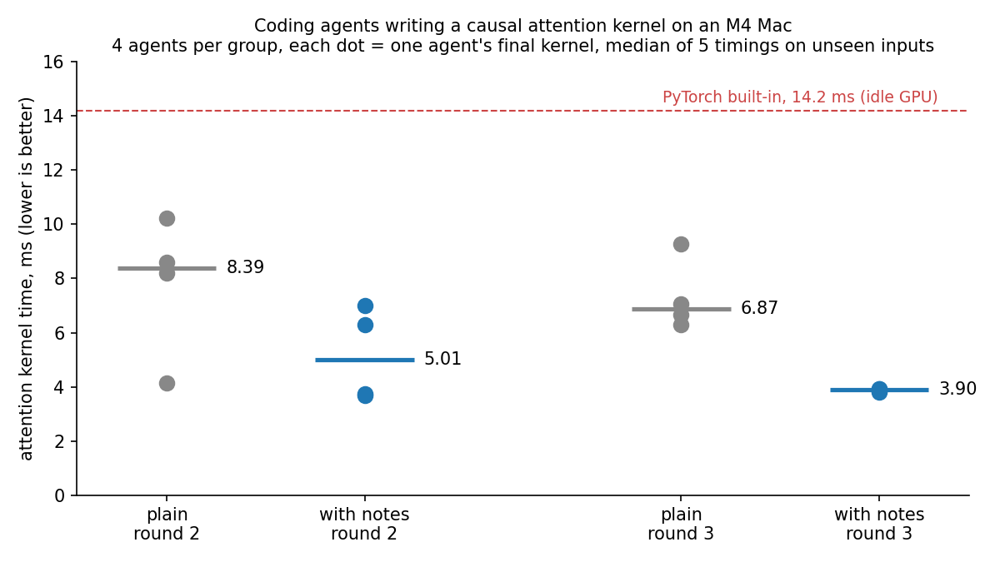

# Do notes from earlier agents make the next agents write faster kernels? (2026-10-14)

Codex agents optimized one causal attention kernel on an Apple M4 Mac (batch 8, 8 heads, 1024 positions,
head size 64, float32). Unchanged code: 59.7 ms on an idle GPU. PyTorch's built-in attention: 14.2 ms.

| Round 3 | Final kernels (ms) | Median | Tokens per agent, median |
|---|---|---|---|
| with notes | 3.80, 3.88, 3.92, 3.94 | 3.90 | 70.8k |
| plain | 6.28, 6.66, 7.08, 9.27 | 6.87 | 76.4k |

| Round 2 | Final kernels (ms) | Median |
|---|---|---|
| with notes | 3.69, 3.74, 6.29, 7.01 | 5.01 |
| plain | 4.14, 8.19, 8.59, 10.24 | 8.39 |

Pass rule, fixed before the batch: the worst notes agent beats the median plain agent. Round 3: 3.94 < 6.87.
Round 2: 7.01 < 8.39.

## Prompts

- plain: "Make kernel() as fast as you can."
- with notes (`lessons-*`): the same, plus: LESSONS.md holds notes from earlier agents on this task; read it before
  the first bench run; before finishing, rewrite it for the next agents (what was faster, what was not, the times;
  keep what is still true; at most 300 words, no code).

Round 1: 4 notes agents with no notes yet. Round N reads the joined notes of round N−1 ([notes-r1.md](notes-r1.md),
[notes-r2.md](notes-r2.md)); [notes-r3.md](notes-r3.md) is what round 3 wrote. The full task text is `TASK` in
[harness/kloop.py](harness/kloop.py).

## How the measurement was kept fair

- Same model and settings, same starting kernel, 10 timed runs per agent, each agent sandboxed to its own folder.
- Notes and plain agents ran at the same time, so load on the GPU hit both groups.
- One timing server timed one kernel at a time; agents never shared the GPU during a measurement.
- Final = a frozen copy of the last kernel.py, timed 5 times on inputs no agent saw (seeds 777–781), median.
- Every timed call is checked against the reference (error ≤ 2e-3).
- If the reference ran more than 10% slower than calibration (`base-r*.json`), the timing was repeated, up to 3 tries.
- All 8 round-3 finals are fused Metal shaders; none calls PyTorch's attention.

## Limits

- 4 agents per group, one task.
- A game ran on the same GPU during rounds 1–3: the unchanged code took 57.9–82.6 ms instead of 59.7 ms. Not yet
  re-timed on an idle GPU (`harness/kidle.py`).
- The notes did not transfer: on cross_entropy and newton_schulz, attention notes did not beat the plain prompt.
- The bench runs in the same process as the kernel; a later hardened bench closes reward hacks this one allows.

## Files

- `agents/<group>-r<round>-<n>/`: each agent's `start.py`, `run1.py`…`run10.py` (the kernel at each bench run),
  `final.py`, `results.jsonl` (every timing), `log.txt` (the agent's full transcript), `TRACE.md`, and the notes
  given and written.
- `harness/`: the scripts used (`kloop.py` launches and times, `bench.py` measures, `agent/` is the starting
  folder). They ran from a private repo where `loop.py` sat in `../loop/`; paths are as they ran on the Mac.
